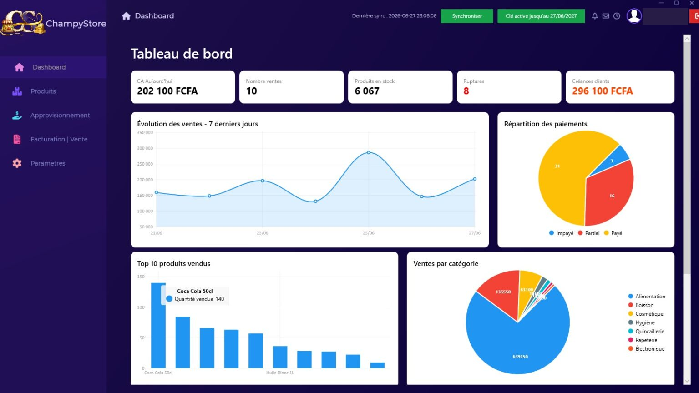
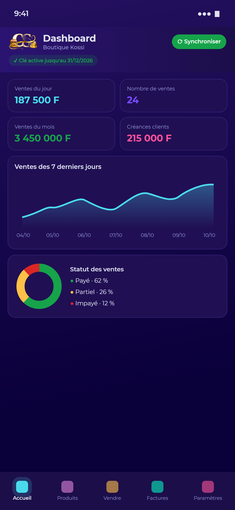
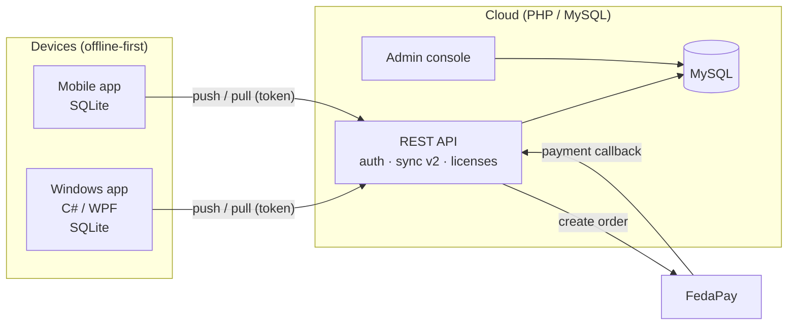

# ChampyStore — Offline-first Retail & Inventory Management

> **Showcase repository.** ChampyStore is a commercial product, so its full source code is private.
> This repository presents the architecture, the design decisions and a few representative code samples.
> Full code walkthrough available on request.

ChampyStore is a point-of-sale and inventory management solution for small shops and businesses in West Africa.
It runs on Windows PCs and smartphones, **works fully offline**, and synchronises every device of a company through a
cloud API as soon as a connection is available.

**Live site:** [mychampystore.com](https://mychampystore.com) · **Author:** Chris KAMAKO — [github.com/Chris-Chp](https://github.com/Chris-Chp)

| Desktop (WPF) | Mobile |
|---|---|
|  |  |

## Features

- **Sales & invoicing** — cart, partial payments, customer credit, PDF invoices, cash-desk validation.
- **Inventory** — products, categories, suppliers, restocking, low-stock alerts, expiry dates.
- **Expenses & customers** — expense tracking, customer balances, activity history / audit log.
- **Dashboards** — daily revenue, 7-day trend, payment status, top products, sales by category.
- **Excel import / export** (XLSX) and a guided onboarding wizard.
- **Multi-device, multi-user** — roles and permissions, company invitation codes.
- **Subscriptions** — online payment (FedaPay: mobile money & cards) with automatic license delivery and activation.
- **Auto-update** of the desktop app and a **web admin console** (companies, licenses, orders, sync monitoring, audit).

## Tech stack

| Layer | Technologies |
|---|---|
| Desktop app | C#, WPF (MVVM), .NET Framework 4.7.2, SQLite, Entity Framework, LiveCharts, ClosedXML |
| Cloud API | PHP, PDO, MySQL (InnoDB transactions & row locks), gzip JSON responses |
| Payments | FedaPay (server-side order creation + payment callback) |
| Admin console | PHP, email one-time-code login, audit log |
| Hosting | Shared Linux hosting (DreamHost) |

## Architecture

## Engineering highlights: the sync protocol (v2)

Several devices of the same company can sell **at the same time, online or offline**. The protocol guarantees that no
write is ever lost and that stock stays consistent. Full spec: [docs/sync-protocol.md](docs/sync-protocol.md).

1. **Offline first.** Every device works on its local SQLite database; each local write is flagged `Synced = 0`.
2. **Global identifiers.** All relations use GUIDs (`SyncId`), never local auto-increment IDs.
3. **Soft deletes.** Nothing is physically deleted (`IsDeleted = 1`), so deletions sync like any other change.
4. **Stock is an event log.** Devices never send an absolute stock level, only signed **stock movements**
   (`-3` for a sale of 3, `+10` for a restock). The server computes stock as `SUM(movements)`.
   Movements are **idempotent** (`INSERT IGNORE` on `SyncId`), so a retried request is never counted twice.
5. **Incremental pull with a cursor.** Each write takes the next per-company version number, allocated under a
   row lock (`SELECT … FOR UPDATE`) inside the transaction. Writes of one company are serialised, so a pull can never
   skip a version committed later. The cursor is read *before* the data: at worst a row is sent twice, never lost.
6. **Local changes win until sent.** A pull never overwrites a local row that has not been pushed yet.
7. **Server-side permissions.** A change rejected by role rules gets its server version bumped, so the next pull
   restores the authoritative value on the device.
8. **Backward compatibility.** v1 clients keep working: their absolute stock values are converted into
   `ADJUSTMENT` movements on the server.

## Security

- Personal per-device API tokens (`X-ChampyStore-Token` header) instead of a shared sync secret.
- Password hashes are **no longer distributed to devices**; devices receive only a short fingerprint to detect a change.
- Strict table allow-lists for any dynamic SQL; prepared statements everywhere.
- License key revealed only to the buyer's browser after a verified payment callback.
- Admin console with email one-time-code login and an audit log.

## Code samples

| File | What it shows |
|---|---|
| [samples/api/sync_common.php](samples/api/sync_common.php) | Version allocation under row lock, idempotent stock movements, stock recomputation, v1 compatibility |
| [samples/api/sync_v2_pull.php](samples/api/sync_v2_pull.php) | Incremental, cursor-based pull endpoint with license check and gzip |
| [samples/desktop/AutoSyncService.cs](samples/desktop/AutoSyncService.cs) | Background auto-sync on the WPF dispatcher, with re-entrancy guard |

Code comments are in French (the product's working language).

## License

© 2026 Chris KAMAKO. All rights reserved. The code samples are published for portfolio purposes only.
